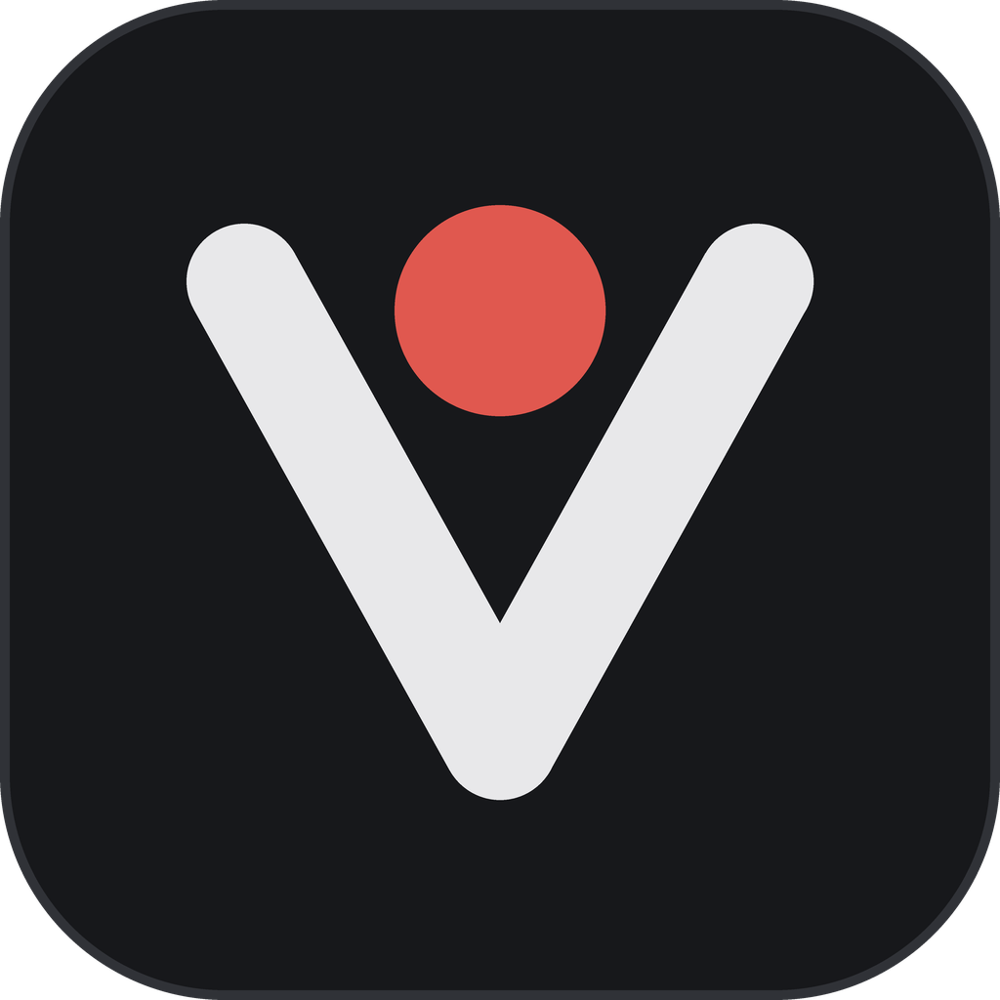
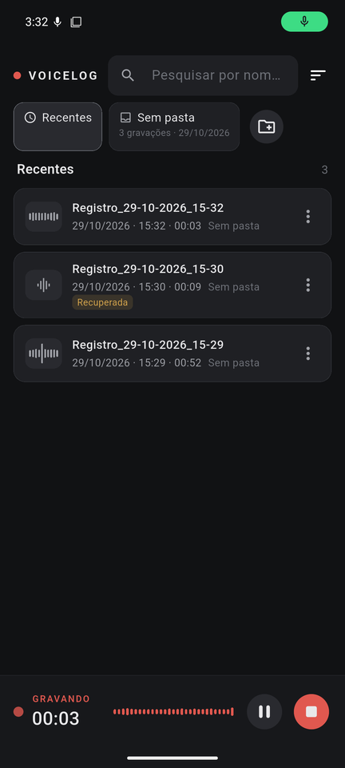
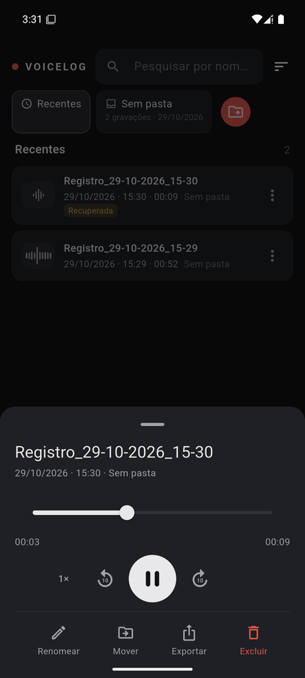
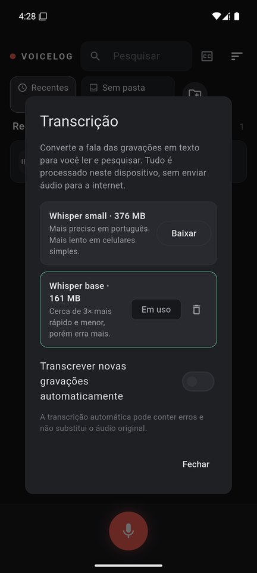
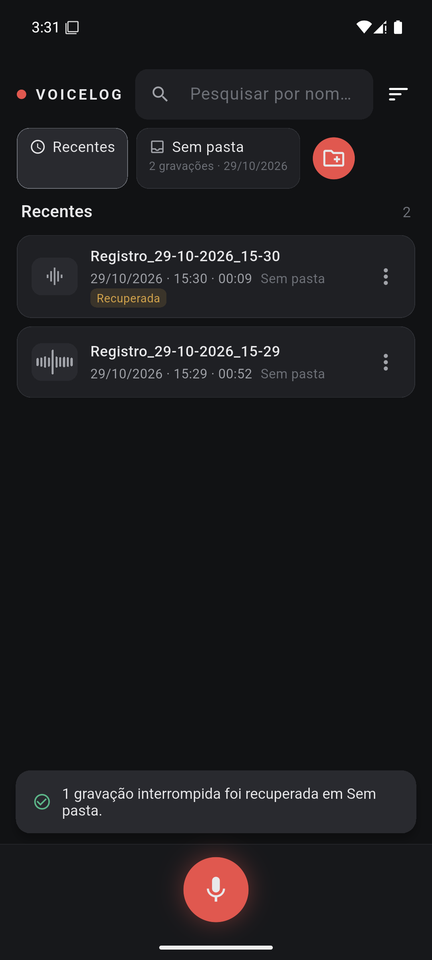

# VoiceLog

**Seu diário de voz: grave ideias em um toque, organize em pastas e encontre depois pelo que você falou.**

Funciona no **Windows** e no **Android**, sem cadastro e sem internet.

  
  
  
  

## ⬇️ Baixar

Acesse a página **[Releases](https://github.com/machntoshh/Voicelog/releases/latest)** e baixe o arquivo do seu aparelho:

| Para | Arquivo |
|---|---|
| 💻 **Windows** 10 ou 11 | `VoiceLog-Setup-1.0.0.exe` |
| 📱 **Android** 7 ou mais recente | `VoiceLog-1.0.0.apk` |

### Instalar no Windows

1. Dê dois cliques em `VoiceLog-Setup-1.0.0.exe` e siga os passos. Não pede senha de administrador.
2. Se aparecer **"O Windows protegeu o seu PC"**, clique em **Mais informações** e depois em **Executar assim mesmo**. O aviso aparece porque o app ainda não tem assinatura digital paga.
3. Pronto: o VoiceLog fica no menu Iniciar. Para deixá-lo na barra de tarefas, clique com o botão direito no ícone e escolha **Fixar na barra de tarefas**.

### Instalar no Android

1. No celular, abra esta página e baixe `VoiceLog-1.0.0.apk`.
2. Toque no arquivo baixado. Se o celular pedir, permita **instalar apps desta fonte** (o navegador ou o app de arquivos).
3. Se o Google Play Protect avisar que o app é desconhecido, toque em **Instalar mesmo assim**. O app ainda não está na Play Store.
4. Na primeira gravação, permita o uso do **microfone** e das **notificações**.

> O APK funciona em celulares de 64 bits, ou seja, praticamente todos os lançados de 2017 para cá.

## 🎙️ Como usar

- **Gravar:** toque no **botão vermelho**. Dá para pausar, retomar e finalizar. No celular, a gravação continua com a tela bloqueada.
- **Salvar:** ao finalizar, escolha um nome e uma pasta. Se fechar a janela sem salvar, a gravação continua guardada em **Sem pasta**.
- **Organizar:** crie pastas como "Trabalho", "Ideias" ou "Diário". Para mover uma gravação, arraste-a até a pasta (no celular, toque e segure) ou use o menu **⋮ → Mover para pasta**.
- **Ouvir:** toque na gravação. Você pode avançar e voltar 10 segundos, mudar a velocidade, renomear, compartilhar ou excluir.
- **Transcrever (opcional):** toque no ícone **CC** no topo e baixe um modelo de transcrição, uma única vez. Depois, no player, toque em **Transcrever** para ver o que foi falado em texto. Tocar num trecho do texto leva o áudio até aquele momento.
- **Pesquisar:** busque pelo nome, pela data, pela pasta ou por **palavras que você falou**. Por exemplo, "reunião" encontra as gravações em que você disse "reunião".

> A transcrição é automática e pode conter erros. Ela não substitui o áudio original.

## 🔒 Privacidade

- **Tudo fica no seu aparelho.** Não há cadastro, propaganda nem coleta de dados. Suas gravações nunca são enviadas para a internet.
- **A transcrição também roda no aparelho.** A internet só é usada uma vez, se você quiser, para baixar o modelo de transcrição.
- **Você controla tudo:** pode exportar ou excluir qualquer gravação quando quiser.
- **Ao gravar outras pessoas,** peça a permissão delas.

**Onde ficam as gravações:**
- **Windows:** na pasta `Documentos\VoiceLog`. Desinstalar o app **não** apaga as gravações.
- **Android:** dentro do próprio app. Desinstalar o app **apaga** as gravações, então exporte antes as que quiser guardar.

## 🗑️ Desinstalar

- **Windows:** Configurações → Aplicativos → VoiceLog → Desinstalar.
- **Android:** toque e segure o ícone do VoiceLog → Desinstalar.

## 📄 Licença

Distribuído sob a licença [MIT](LICENSE): você pode usar, copiar, modificar e compartilhar livremente, mantendo o aviso de copyright.
